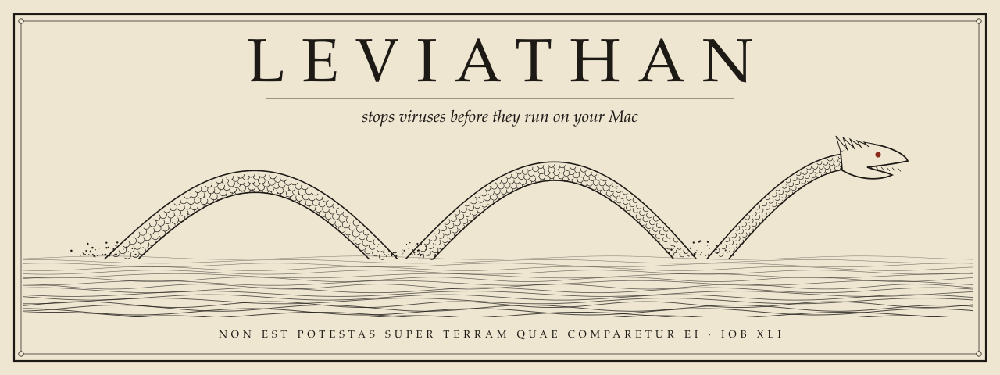

<picture>
  <source media="(prefers-color-scheme: dark)" srcset="art/banner-dark.svg">
  
</picture>

# Leviathan

**Leviathan stops viruses before they run on your Mac.** It moves real malware where it can't run, blocks scam and malware sites in every app, and stops the "paste this command" trick. It stays silent the rest of the time, and every action can be undone.

Version 1.0.0. Finished and tested: 34 of 34 tests pass on macOS 26 (Apple silicon).

## Install

<a href="#one-line-install"><picture><source media="(prefers-color-scheme: dark)" srcset="art/install-dark.svg"></picture></a>
&nbsp;
<a href="https://github.com/Questboy23/leviathan/releases/latest/download/Leviathan.zip"><picture><source media="(prefers-color-scheme: dark)" srcset="art/download-dark.svg"></picture></a>

You need a Mac and [Homebrew](https://brew.sh). Leviathan installs its 3 helpers (dnscrypt-proxy, yara, python) through Homebrew by itself.

### One-line install

1. Open Terminal: press Cmd+Space, type `Terminal`, press Return.
2. Paste this line and press Return:

```
cd ~ && curl -fsSL https://github.com/Questboy23/leviathan/archive/refs/tags/v1.0.0.tar.gz | tar xz && bash leviathan-1.0.0/install.sh
```

3. Type your Mac password when asked. The screen shows no dots while you type. That is normal.
4. If macOS asks whether `python3` may access Downloads, click Allow.

Done. It takes about 1 to 3 minutes.

### Zip install

1. Click **Download the zip** above. Your Mac unzips it into Downloads.
2. Open Terminal, type `bash ` (with a space), drag `install.sh` from the unzipped folder into the window, press Return.

## What it does

| Watch | What it catches | What it does |
|---|---|---|
| I. Downloads and apps | Files matching Apple's own malware rules (XProtect), apps whose developer Apple revoked, files downloaded from known malware sites | Moves them to a folder where they can't run. `leviathan undo` puts them back. |
| II. Auto-start items | Programs that set themselves to start at login while pretending to be Apple, or hiding unsigned in a secret folder | Switches them off and moves them out. Undoable. |
| III. Paste guard | Pasted Terminal commands that download and run code, unscramble hidden code, strip Apple's safety check, or draw a fake password box | Stops the command once and says why. Press Enter again to run it anyway. |
| IV. Site filter | About 300,000 known scam and malware sites, refreshed every hour, plus Quad9 and Cloudflare malware filtering | The site never loads, in any app. A watchdog switches back to normal internet within 20 seconds if the filter fails or a hotel Wi-Fi login page needs it. |
| V. Settings | Firewall off, Apple's app checks off, security updates off, AirDrop open to everyone | Turns each one on. Undoable. Also reports disk encryption, remote login and settings profiles. |

**It only acts on things no one wants on their computer.** Unsigned apps, cracked apps and homemade scripts are never blocked or labeled. They still get checked for actual malware.

**Nothing leaves your Mac** except website lookups (sent encrypted to Quad9 or Cloudflare) and the hourly list download.

## Use

```
leviathan scan        check everything now: apps, Downloads, auto-start, network openings, settings
leviathan             show everything it did, with an undo number for each
leviathan undo 12     undo entry 12
leviathan verify      check that the log has not been edited
```

`leviathan scan` changes nothing. On the test Mac it checked 50 apps and 29 downloads in 76 seconds.

## What it can't do

- **A brand-new flaw in macOS itself** can be attacked without you doing anything. Only Apple's updates fix those, which is why Leviathan keeps automatic security updates on.
- **Malware no list knows yet** gets through the download check. The paste guard and fake password box watch still catch the most common way Mac password stealers get in.
- **Intel Macs** should work through Homebrew's `/usr/local` paths but were not tested.

## How it stays safe itself

- Every program that runs as administrator (root) lives in root-owned folders: `/Library/Application Support/Leviathan` and `/var/db/leviathan`. A program running as you can't edit them, so malware can't use Leviathan to gain admin rights.
- Root uses Apple's own Python (`/usr/bin/python3 -I`), never one from Homebrew.
- Root's undo log is separate from yours, so a changed file in your home folder can never be run as root.
- Your log and quarantine folder are readable by you only.
- The background watcher wakes only when a watched folder changes. It does not scan on a timer.

## Uninstall

```
bash ~/.leviathan/bin/uninstall.sh
```

This removes every part, puts your DNS back, and reverses every setting Leviathan changed. Add `--keep-settings` to leave the settings as they are. Anything it caught stays in `~/.leviathan/quarantine`, where it can't run.

## Tests

```
bash tests.sh
```

The tests use a throwaway folder and change no system settings. They plant a harmless fake virus, a fake Apple auto-start job and a fake password box, then check that each one is stopped and undone correctly.

## License

MIT. See `LICENSE`. The banner is drawn by `art/make_art.py`.
