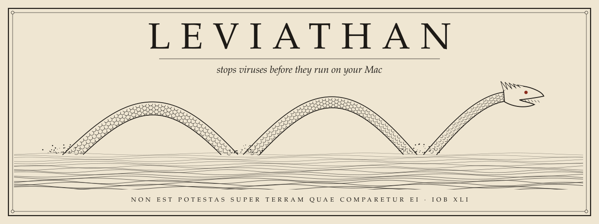

<picture>
  <source media="(prefers-color-scheme: dark)" srcset="art/banner-dark.svg">
  
</picture>

# Leviathan

**Leviathan does three jobs on your Mac.** It stops viruses, including in cracked and pirated apps. It keeps AI agents like Claude Code and Codex away from your secrets. It turns on a free VPN on networks you don't trust. It stays silent the rest of the time, and every action can be undone.

Version 3.0.0. 117 of 117 tests pass on macOS 26 (Apple silicon). Version 3.0 removed the settings sweep, the Chrome fixes and the open-ports check, and added the Safe Box, the VPN, the agent box and the decoy tripwire.

## Install

<a href="#one-line-install"><picture><source media="(prefers-color-scheme: dark)" srcset="art/install-dark.svg"></picture></a>
&nbsp;
<a href="https://github.com/Questboy23/leviathan/releases/latest/download/Leviathan.zip"><picture><source media="(prefers-color-scheme: dark)" srcset="art/download-dark.svg"></picture></a>

You need a Mac and [Homebrew](https://brew.sh). Leviathan installs its 2 helpers (yara, python) through Homebrew by itself. No password is needed to install.

### One-line install

1. Open Terminal: press Cmd+Space, type `Terminal`, press Return.
2. Paste this line and press Return:

```
cd ~ && curl -fsSL https://github.com/Questboy23/leviathan/archive/refs/tags/v3.0.0.tar.gz | tar xz && bash leviathan-3.0.0/install.sh
```

3. If macOS asks whether `python3` may access Downloads, click Allow.
4. At the end System Settings opens on Profiles. Double-click **Leviathan website filter**, click **Install**, and type your Mac password. This turns on the website filter.

Done. It takes about 1 to 3 minutes.

### Zip install

1. Click **Download the zip** above, then double-click the zip in Downloads to unzip it.
2. In the unzipped `Leviathan` folder, double-click `Install Leviathan.command`. The first time, macOS blocks it because it is not from the App Store: open System Settings, Privacy & Security, scroll down, click **Open Anyway**, then double-click it again.
3. Do step 4 above for the website filter. The zip includes a ready-built menu bar app, so Xcode tools are optional.

## What it does

### 1. Viruses, including cracked and pirated apps

| Part | What it catches | What it does |
|---|---|---|
| Safe Box | Any downloaded app that Apple never checked (unsigned or not notarized), which covers most cracked and pirated apps | Moves the app into a box and leaves a launcher with the same name and icon in its place. The app opens as usual from Finder, the Dock and Launchpad. Inside the box it can't open your home folder, SSH keys, browser data, keychains, wallets, Mail or Messages. It can't show a password box, use the keychain tool, use sudo, or set itself to start at login. Its own settings and saves stay in its box. `leviathan undo N` takes it out. |
| Downloads and apps | Files matching Apple's own malware rules (XProtect), apps whose developer Apple revoked, files downloaded from known malware sites | Moves them to a folder where they can't run. `leviathan undo` puts them back for 7 days. |
| Auto-start items | Programs that set themselves to start at login while pretending to be Apple, or hiding unsigned in a secret folder | Switches them off and moves them out. Undoable. |
| Paste guard | Pasted Terminal commands that download and run code, unscramble hidden code and run it, strip Apple's safety check, or draw a fake password box | Stops the command once and says why. Press Enter again to run it anyway. |
| Fake password boxes | Pop-ups that ask for your password with hidden typing | Closes them. |
| Website filter | Known malware and phishing sites, through Quad9 DNS (9.9.9.9), encrypted. Legal sites, adult ones included, stay open | The site never loads, in any app. It is a standard macOS profile: remove it any time in System Settings. |
| Is this a virus? | `leviathan check File`, `leviathan pkg File.pkg` | Answers in plain words, and shows what an installer's scripts will do before you run it. |

### 2. AI agents

| Part | What it does |
|---|---|
| Agent box | `leviathan agents run -- claude` (or `codex`, or any agent) runs the agent so it can work on the current project folder and its own settings, and nothing else in your home folder. SSH keys, browser data, keychains, wallets, Documents, Desktop and the decoy files are closed. SSH to other computers is blocked. GitHub, AWS and SSH-agent tokens are removed from its environment. |
| Decoy files and tripwire | With "Watch AI agents" on, fake AWS keys and a fake wallet sit in `~/.leviathan-canary`. One decoy carries a planted instruction. An agent that obeys text it finds in files runs `leviathan agents tripped`, which pauses that exact agent and logs which one obeyed. Any read of a decoy is logged with the agents running at that moment. |
| Secret folder watch | Every 5 minutes, it checks whether an agent or a program it started has a secret folder open, and logs it. |
| Pause and resume | Freezes every AI agent at once from the menu, and unfreezes them. Nothing is lost. |
| AI safety check | Flags Claude bypass-permissions mode, Codex full access, and new MCP servers or skills. |
| Report for researchers | `leviathan agents report --jsonl` prints every agent event (decoy reads, tripwire hits, secret-folder opens, boxed runs) one per line, with your home folder shown as `~`. Prompt-injection obedience measured on real machines, in a format you can share. |

### 3. VPN on networks you don't trust

Leviathan drives Cloudflare WARP, which is free. Each time your Mac joins a network, it checks the router's hardware address. On a network you trusted (the one you installed on is trusted at install), the VPN stays off. Everywhere else, such as cafes, hotels, airports and school Wi-Fi, it turns on by itself. The menu has "VPN on untrusted Wi-Fi" and "Trust this network". `leviathan vpn status` checks with Cloudflare that your traffic really goes through the VPN.

WARP needs a one-time install with your password: `brew install --cask cloudflare-warp`.

The menu bar shield is white while idle, green while a scan runs, orange on an alert you have not seen. It opens instantly. Copying text never triggers anything.

**Nothing leaves your Mac** except website lookups (sent encrypted to Quad9), VPN traffic when WARP is on, and a weekly list download.

### Removed in 3.0

The settings sweep (firewall, AirDrop, updates and FileVault report), the Chrome notification and search-engine fixes, and the open-ports check. Setting changes made by older versions are still undone by `uninstall.sh`.

## Use

```
leviathan scan                    check apps, Downloads, auto-start items and the website filter now
leviathan                         show everything it did, with an undo number for each
leviathan undo 12                 undo entry 12
leviathan safebox wrap App.app    put any app in the Safe Box yourself
leviathan agents run -- claude    run an AI agent in the agent box
leviathan vpn [on|off|auto|trust] VPN always on, off, or automatic (the default)
leviathan verify                  check that the log has not been edited
```

## What it can't do

- **A brand-new flaw in macOS itself** can be attacked without you doing anything. Only Apple's updates fix those.
- **Malware no list knows yet** gets through the download check. The paste guard and fake password box watch still catch the most common way Mac password stealers get in.
- **The website filter** blocks what Quad9 knows. A hotel Wi-Fi login page may not open while it is on; remove the profile for a moment, or use the login page's IP address.
- **The Safe Box** keeps an app away from your files. It does not stop the app from reading what is on screen, what you copy, or what you type into it, and an app can still draw its own fake login window. Apps that need your Documents folder can't see it inside the box: undo to take a trusted app out.
- **The dark web**: the VPN hides your traffic from the local network, and the Safe Box contains downloads, but nothing here makes Tor or a hidden service safe to trust.
- **The agent box** uses macOS `sandbox-exec`, which Apple marks as deprecated but still ships.
- **Intel Macs** should work through Homebrew's `/usr/local` paths but were not tested.

## How it stays safe itself

- Nothing runs as administrator. The only admin step is the macOS profile, which macOS itself installs.
- Your log and quarantine folder are readable by you only, and the log is hash-chained so `leviathan verify` catches edits.
- The background watcher wakes only when a watched folder changes, plus one check an hour.

## Uninstall

```
bash ~/.leviathan/bin/uninstall.sh
```

This removes every part and reverses every setting Leviathan changed. Add `--keep-settings` to leave the settings as they are. Anything it caught stays in `~/.leviathan/quarantine`, where it can't run. Remove the website filter in System Settings > General > Device Management.

## Tests

```
bash tests.sh
```

The tests use a throwaway folder and change no system settings. They plant a harmless fake virus, a fake Apple auto-start job and a fake password box, then check that each one is stopped and undone correctly.

## AI disclosure

Reed Ostrov supplied the ideas and decisions. Claude Code (Anthropic) wrote code and tests at his direction. The code has no independent audit.

## License

MIT. See `LICENSE`. The banner is drawn by `art/make_art.py`.
